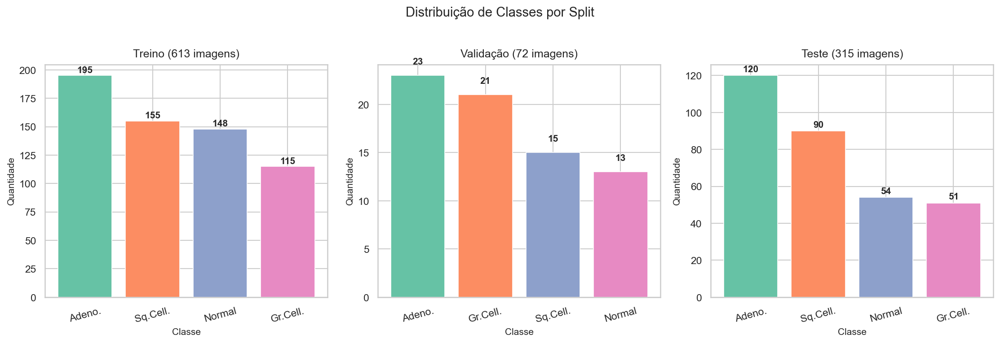
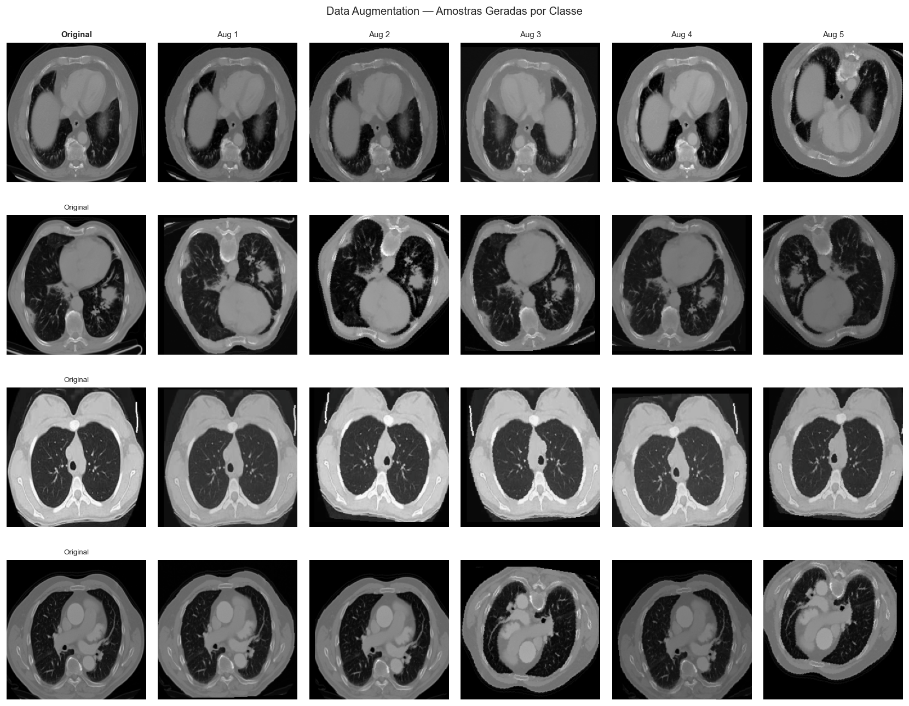
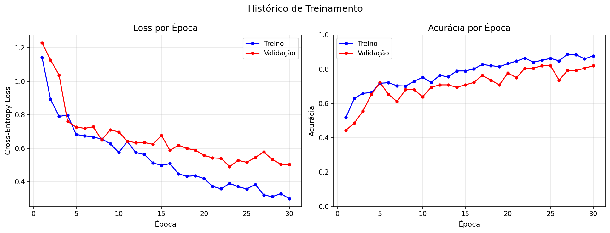
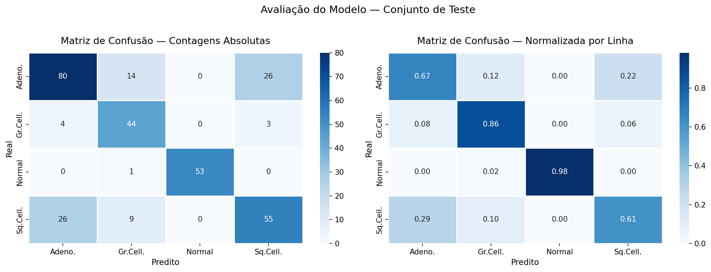
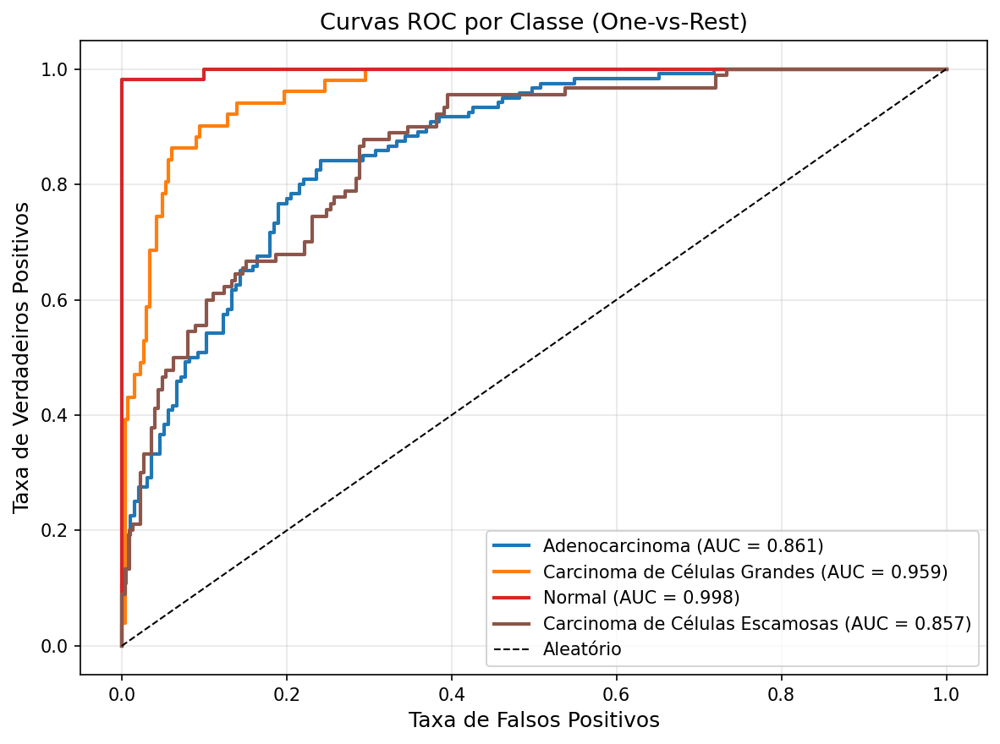

# Lung Cancer Classification on CT Scans: Deep Learning with PyTorch

Deep learning project for the automatic classification of chest computed tomography (CT) images into 4 clinical categories, using Transfer Learning with ResNet50.

---

## Tech Stack


---

## Why this project matters

Lung cancer is the **leading cause of cancer death worldwide**, responsible for more than 1.8 million deaths per year according to the WHO. Early diagnosis is the most decisive factor for survival: patients detected at an early stage have a 5-year survival rate of up to **56%**, compared with only **5%** in advanced cases.

Computed tomography is the gold-standard screening exam, but manual interpretation by radiologists is:

- **Time-consuming:** each CT scan contains hundreds of slices to analyze
- **Scarce:** there is a shortage of specialists, especially in remote regions
- **Subject to variation:** fatigue and subjectivity affect the diagnosis

This project shows that deep learning models can **automatically classify** lung cancer subtypes on CT images with high confidence (macro AUC-ROC of **0.919**), paving the way for clinical decision support tools that make diagnosis faster, more accessible and more consistent.

---

## Results

| Metric | Value |
|---------|-------|
| Test accuracy | **73.65%** |
| Macro AUC-ROC | **0.919** |
| Test samples | 315 |
| Training accuracy | 87.77% |
| Validation accuracy | 81.94% |

---

## Project Visualizations

### Class Distribution



The dataset is **class-imbalanced**: adenocarcinoma is the dominant class (195 training samples), while large cell carcinoma is the minority (115). This imbalance was handled with a `CrossEntropyLoss` weighted by inverse class frequency.

---

### Data Augmentation Examples



To artificially increase the diversity of this small dataset (613 training samples), augmentations suited to medical images were applied: slight rotations, horizontal flips, brightness/contrast variation and ImageNet normalization. Aggressive augmentations (severe geometric distortions) were avoided so as not to compromise clinically relevant features.

---

### Training History



The model was trained in **2 phases**: in Phase 1 only the classification head was trained (frozen backbone), and in Phase 2 the last 30 layers of ResNet50 were unfrozen for fine-tuning with a lower learning rate. Early Stopping with a patience of 7 epochs prevented overfitting.

---

### Confusion Matrix



The matrix shows that the model performs best on **adenocarcinoma** and struggles most with **large cell carcinoma**, the class with the fewest samples. Confusion between histological subtypes is expected even in real clinical settings, where a biopsy is required for definitive confirmation.

---

### ROC Curves per Class



The ROC curves show the model's **excellent discriminative ability**, with a macro AUC-ROC of 0.919. Every class reaches an AUC above 0.87, indicating that the model learned relevant discriminative features for each subtype.

---

## Dataset & License

### Source

**Chest CT-Scan images Dataset**, publicly available on Kaggle.

> A dataset of anonymized chest computed tomography images,
> organized into 4 clinical classes and split into training, validation and test sets.

The data is **not included in this repository**. To reproduce the project, download the dataset directly from Kaggle and organize it according to the structure described below.

### Sample distribution

| Split | Adenocarcinoma | Large Cell Carcinoma | Normal | Squamous Cell Carcinoma | Total |
|-------|:--------------:|:--------------------:|:------:|:------------------:|:-----:|
| Train | 195 | 115 | 148 | 155 | **613** |
| Validation | 23 | 21 | 13 | 15 | **72** |
| Test | 120 | 51 | 54 | 90 | **315** |

### Data license

The data is made available under the **[Open Database License (ODbL) v1.0](https://opendatacommons.org/licenses/odbl/1-0/)**.

In accordance with section 4.3 of the ODbL:

> *Contains information from the Chest CT-Scan images Dataset, which is made available under the [Open Database License (ODbL) v1.0](https://opendatacommons.org/licenses/odbl/1-0/).*

**Summary of permissions:**
- Free use, including commercial use
- Modifications allowed
- Redistribution requires keeping the same ODbL license
- Attribution required when used publicly

---

## Project Challenges

### 1. A small dataset for deep learning
With only 613 training images, training a CNN from scratch would not be feasible. The solution was **Transfer Learning** with a ResNet50 pretrained on ImageNet: the model starts with knowledge of general visual features and only adapts the final layers to the medical domain.

### 2. Class imbalance
The gap between the largest class (195 samples) and the smallest (115) biases predictions. A **`CrossEntropyLoss` with weights inversely proportional to each class frequency** was implemented, penalizing errors on rare classes more heavily.

### 3. Overfitting on medical images
CT images have very specific characteristics. To generalize well with little data, the augmentations had to be carefully calibrated: strong enough to regularize, but without distorting clinically relevant information (such as nodular texture and density patterns).

### 4. Two-phase fine-tuning strategy
Unfreezing the entire backbone at once with a high learning rate would destroy the pretrained weights. The solution: **Phase 1** trains only the head with `LR=1e-3`, then **Phase 2** unfreezes the last 30 layers with `LR=1e-4`, preserving the low-level features learned on ImageNet.

### 5. Environment compatibility on macOS
Python 3.14+ removed internal APIs used by PyTorch, so **Python 3.11** with an isolated `venv` was required. In addition, macOS blocks SSL certificates by default, which required manual configuration to download the pretrained weights.

---

## Architecture

- **Backbone:** ResNet50 pretrained on ImageNet (Transfer Learning)
- **Head:** `BatchNorm → Dropout → Linear(2048→256) → ReLU → Linear(256→4)`
- **Training strategy:**
  - Phase 1: frozen backbone, trains only the head (10 epochs, LR=1e-3)
  - Phase 2: fine-tuning of the last 30 layers (up to 30 epochs, LR=1e-4)
- **Loss:** CrossEntropyLoss with class weights
- **Optimizer:** Adam with L2 weight decay
- **Scheduler:** ReduceLROnPlateau
- **Early Stopping:** patience of 7 epochs

---

## Project Structure

```
chest/
├── notebooks/
│   ├── 01_exploracao_dados.ipynb     # EDA and visual analysis
│   ├── 02_preprocessamento.ipynb    # Pipeline validation
│   ├── 03_treinamento.ipynb         # Training (2 phases)
│   └── 04_avaliacao.ipynb           # Metrics and error analysis
│
├── src/
│   ├── config.py       # Central settings (paths, hyperparameters)
│   ├── dataset.py      # PyTorch Dataset + DataLoaders
│   ├── modelo.py       # Transfer Learning architecture
│   ├── treinamento.py  # Training loop + Early Stopping
│   └── avaliacao.py    # Metrics, confusion matrix, ROC curves
│
├── modelos_salvos/     # Checkpoints (.pth)
├── logs/               # TensorBoard logs
├── reports/
│   ├── eda/            # Exploratory analysis
│   ├── training/       # History and augmentations
│   └── evaluation/     # Metrics and predictions
├── requirements.txt
└── README.md
```

---

## Environment Setup

```bash
# 1. Clone the repository
git clone https://github.com/Filip3Owl/lung-ct-deep-learning.git
cd lung-ct-deep-learning

# 2. Create and activate a virtual environment with Python 3.11
python3.11 -m venv venv
source venv/bin/activate        # macOS/Linux
# venv\Scripts\activate.bat     # Windows

# 3. Install the dependencies
pip install -r requirements.txt

# 4. Start Jupyter
jupyter notebook notebooks/
```

---

## Notebook Workflow

| # | Notebook | What it does |
|---|----------|-----------|
| 1 | `01_exploracao_dados.ipynb` | Exploratory analysis: class distribution, visual samples, dimensions |
| 2 | `02_preprocessamento.ipynb` | Checks integrity, validates augmentations, computes class weights |
| 3 | `03_treinamento.ipynb` | Trains the model in 2 phases with Early Stopping |
| 4 | `04_avaliacao.ipynb` | Evaluates on the test set: accuracy, AUC-ROC, confusion matrix, error analysis |

---

## Main Dependencies

| Package | Version | Purpose |
|--------|--------|-----|
| PyTorch | 2.2.x | Deep learning framework |
| torchvision | 0.17.x | Pretrained models and transforms |
| scikit-learn | 1.5.x | Classification metrics |
| Pillow | any | Image loading and processing |
| albumentations | 1.4.x | Advanced augmentations |
| matplotlib / seaborn | any | Visualizations |
| jupyter | any | Running the notebooks |
| tqdm | any | Progress bars |
| tensorboard | any | Training monitoring |
